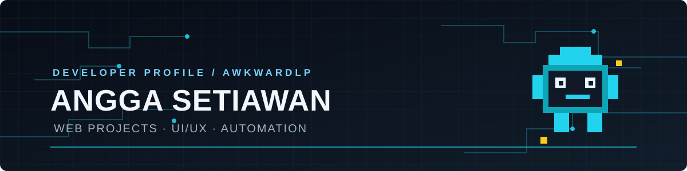
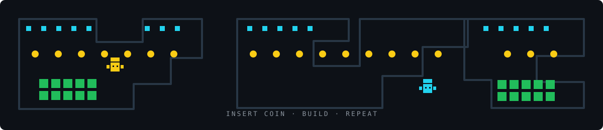
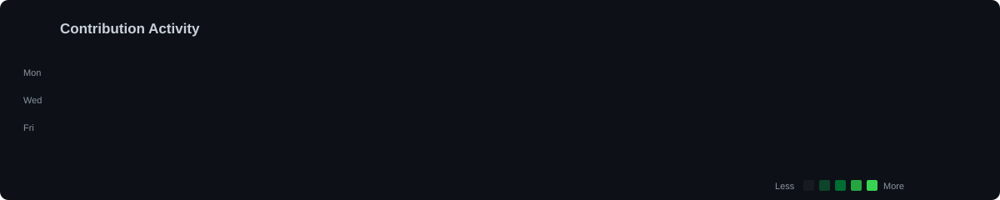

  

<h2 align="center">Hey, I'm Awkward 👋</h2>

  Building web projects and interactive tools. I enjoy working across frontend, interface design, and practical automation.

  

---

### Tech Stack

  

## About Me

**I'm Angga Setiawan, an independent developer who enjoys building digital projects across web development and UI/UX design.**

**Currently exploring frontend development, interface design, and practical automation through personal projects.**

### Selected projects

| Project | What it is |
|---|---|
| [9Score](https://github.com/Awkwardlp/9score) | Browser extension project for the Mentari UNPAM LMS. |
| [365 Arcade](https://github.com/Awkwardlp/365-arcade) | JavaScript project. |
| [MyCAA Cookies](https://github.com/Awkwardlp/mycaa-cookies) | TypeScript project. |
| [Simple E-commerce](https://github.com/Awkwardlp/simple-e-commerce) | HTML/CSS storefront project. |
| [Caca Birthday](https://github.com/Awkwardlp/caca-birthday) | JavaScript project. |
| [Portfolio](https://github.com/Awkwardlp/portofolio) | Personal portfolio project. |

### GitHub Stats

  

  

  

### Play With Me

  

  

  <picture>
    <source media="(prefers-color-scheme: dark)" srcset="https://raw.githubusercontent.com/Awkwardlp/Awkwardlp/output/github-snake-dark.svg" />
    <source media="(prefers-color-scheme: light)" srcset="https://raw.githubusercontent.com/Awkwardlp/Awkwardlp/output/github-snake.svg" />
    
  </picture>

<i>Thanks for stopping by — check out my repositories.</i>

