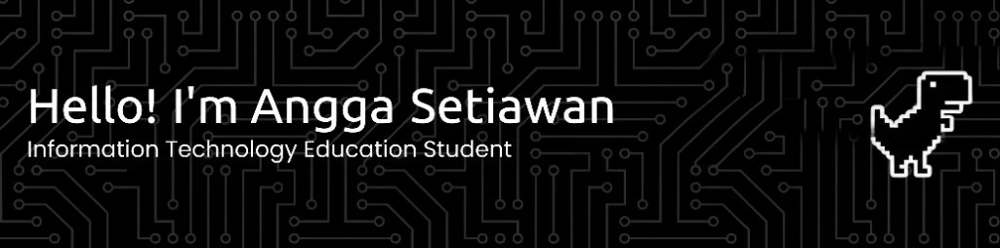

## Tech Stack

 
## About Me

**I'm an Information Technology Education student at Universitas Pamulang who enjoys building digital products that combine technology, design, and user experience**.

**Currently, I'm exploring Software Development, UI/UX Design, and Artificial Intelligence while building personal and academic projects.**

## GitHub Stats
 

## Play With Me

###

<picture data-importer="pacman">
  <source media="(prefers-color-scheme: dark)" srcset="https://raw.githubusercontent.com/Awkwardlp/Awkwardlp/pacman-output/pacman-contribution-graph-dark.svg">
  <source media="(prefers-color-scheme: light)" srcset="https://raw.githubusercontent.com/Awkwardlp/Awkwardlp/pacman-output/pacman-contribution-graph.svg">
  
</picture>

###

<picture data-importer="snake">
  <source media="(prefers-color-scheme: dark)" srcset="https://raw.githubusercontent.com/Awkwardlp/Awkwardlp/output/github-snake-dark.svg">
  <source media="(prefers-color-scheme: light)" srcset="https://raw.githubusercontent.com/Awkwardlp/Awkwardlp/output/github-snake.svg">
  
</picture>

###
